# Notes Graph

Notes Graph shows an Apple Notes library as an interactive graph of the links between notes, and gives AI assistants an MCP server that reads those notes with their formatting and links intact and can edit them. It exists because Apple Notes has no graph view, and because an assistant working on notes needs to read their structure and to change one part of a note without rebuilding the rest. What is and is not preserved is listed under [Fidelity](#fidelity).

This repository is a snapshot of a private working repo that was designed for personal use.

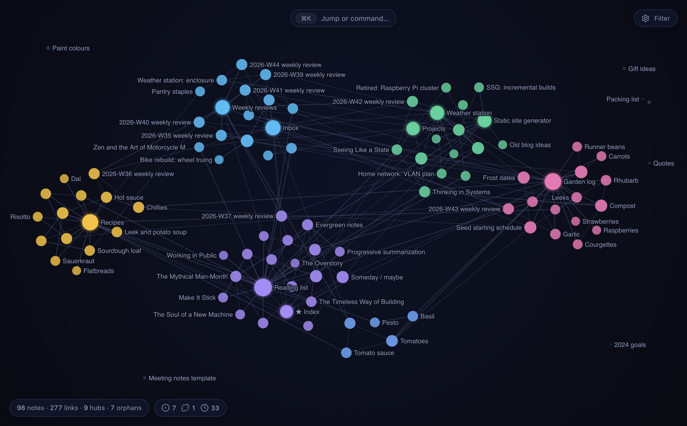

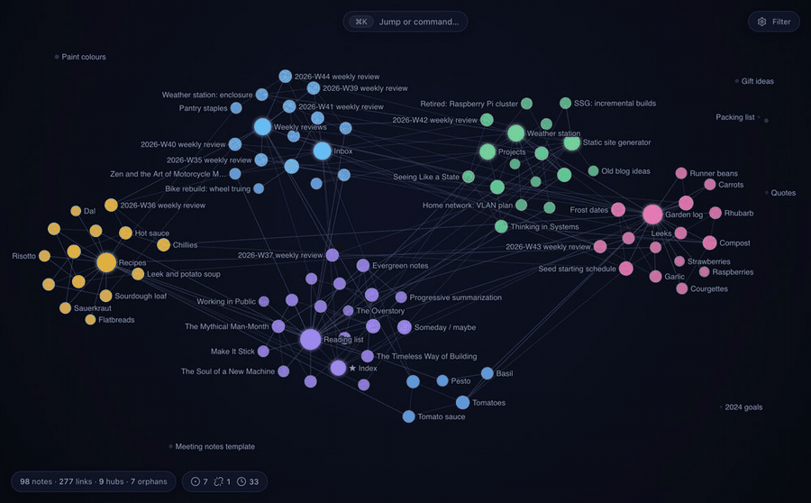

Everything pictured here is the invented demo library in `demo/`, not anyone's real notes.

| | |
|---|---|
| 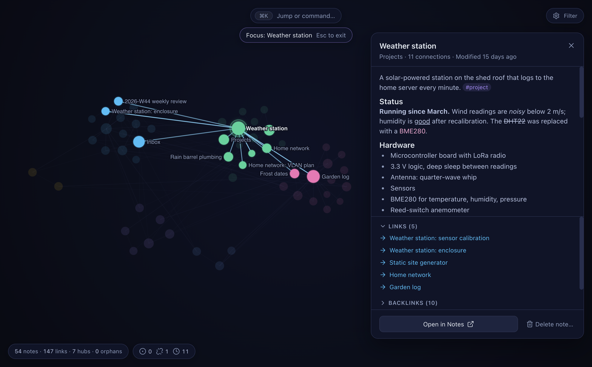 | 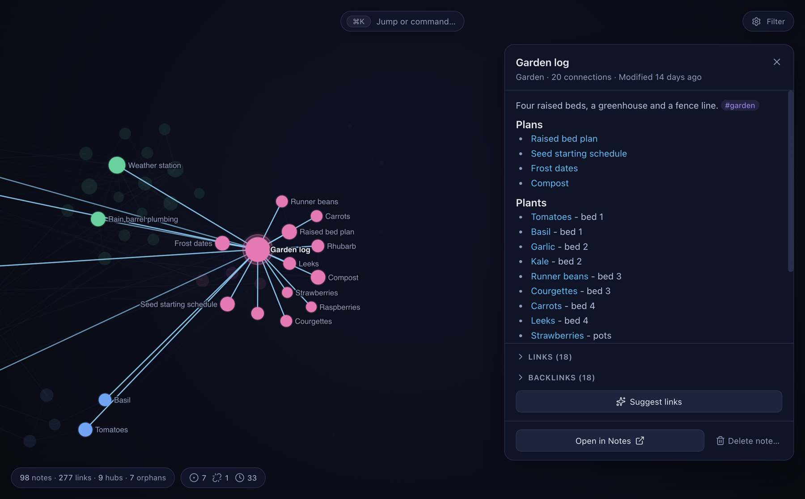 |
| Focus mode: a note, its two-hop neighbourhood, and the note itself rendered in the side panel. | A selected hub with its neighbours highlighted and its links listed. |
| 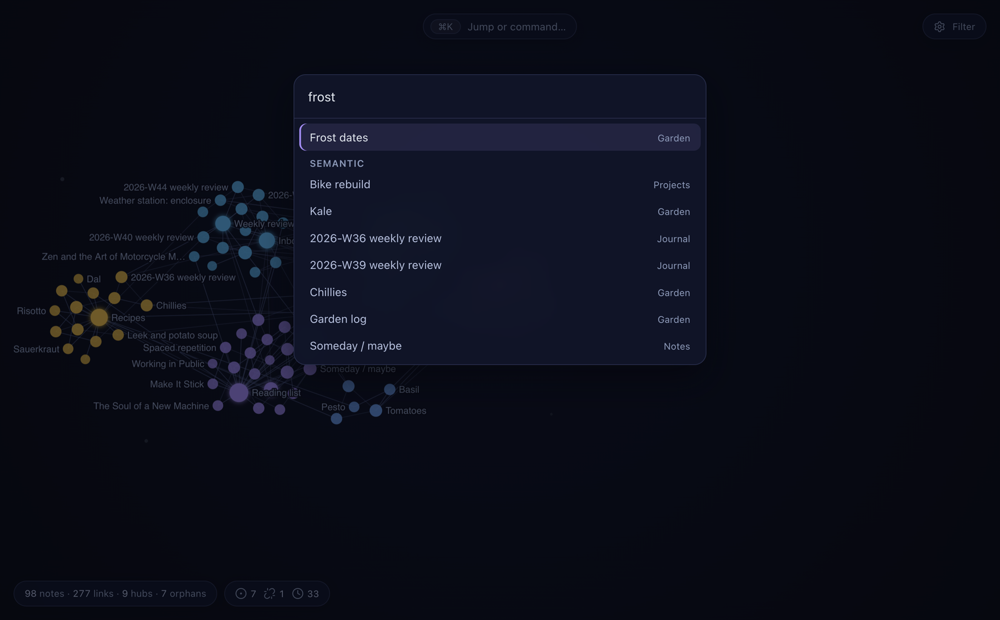 | 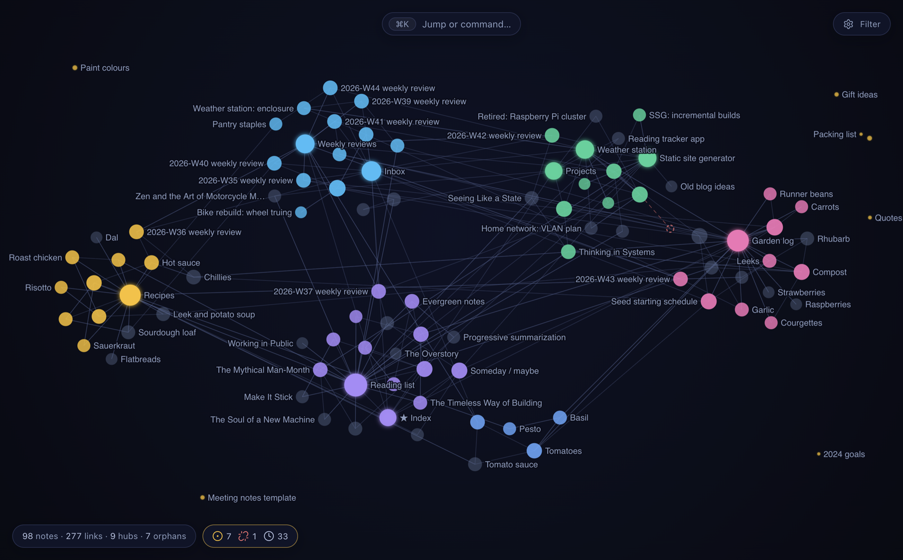 |
| The palette: fuzzy title matches first, then semantic matches. | The health lens: orphans ringed, stale notes greyed, a broken link drawn as a dashed ghost node. |
| 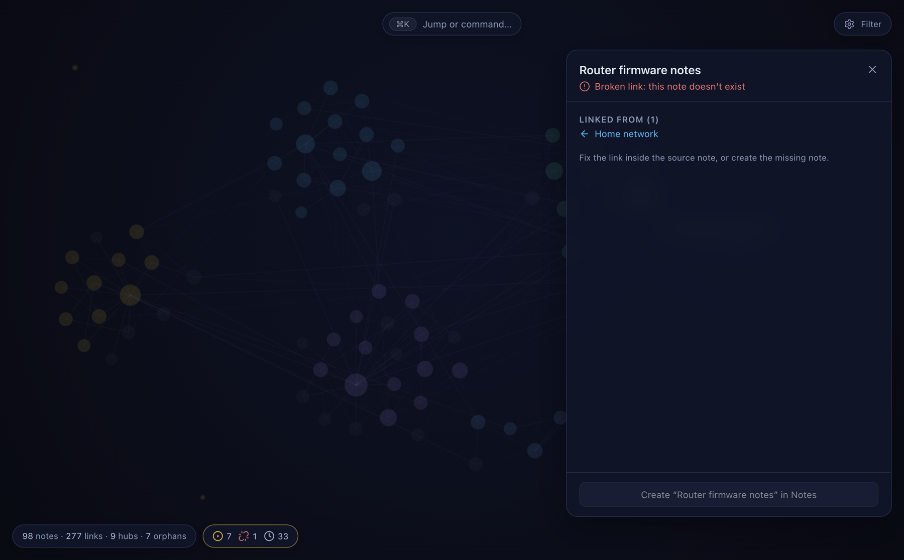 | 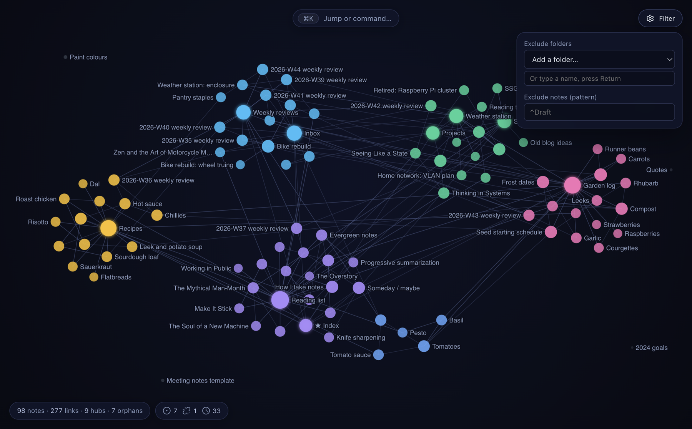 |
| A broken link's ghost node and the note that still points at it. | Filters: hide folders or notes matching a pattern. |

The MCP server, called over stdio against the same demo library:

| | |
|---|---|
| 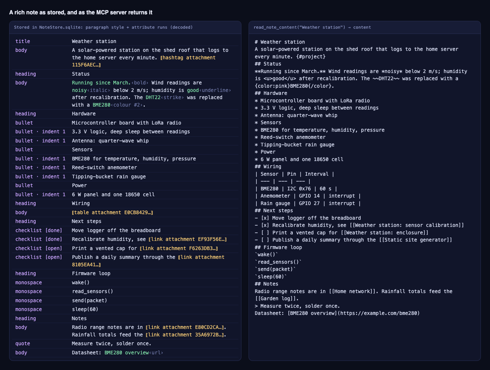 | 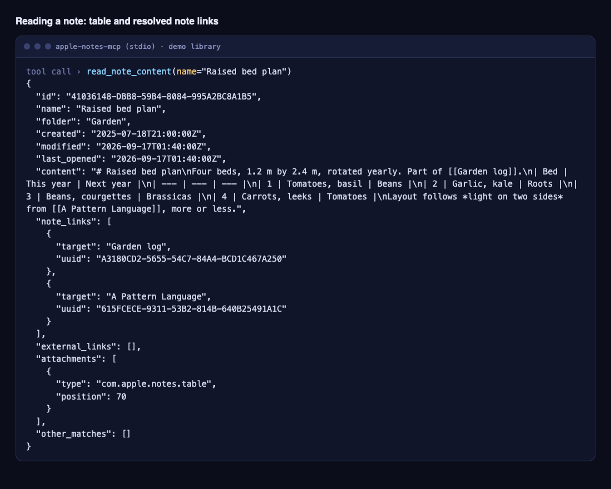 |
| Left: what Notes stores for one note (paragraph styles, attribute runs, attachments). Right: what `read_note_content` returns. Headings, inline formatting, checklists, the table, tags and note links survive; list indent levels do not (nested items come back flat). | A table and `[[note links]]` resolved to titles and ids. |
| 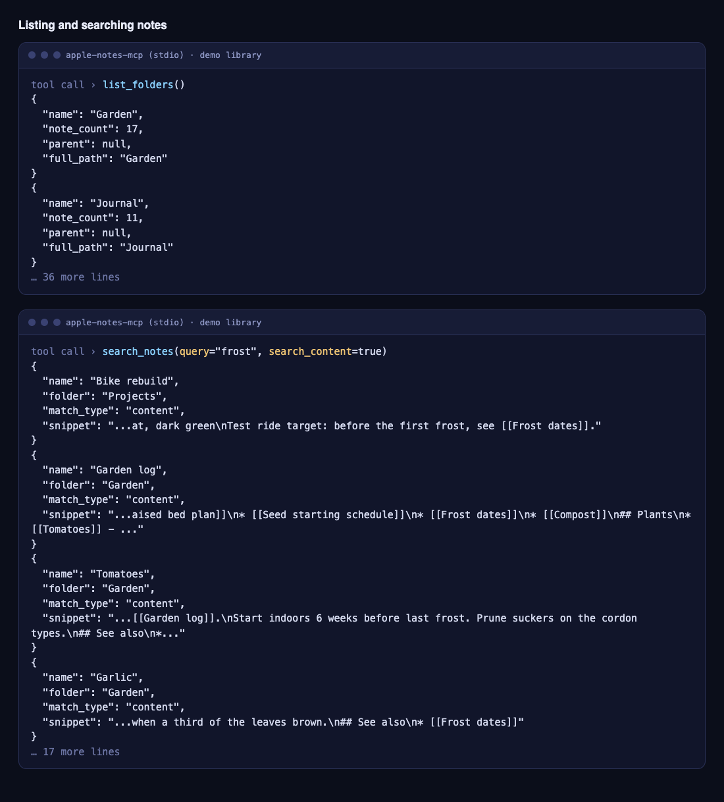 | 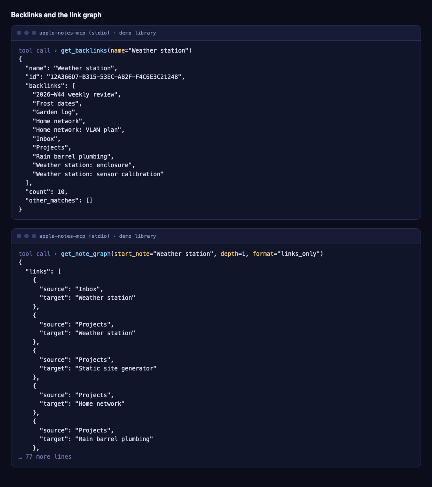 |
| `list_folders` and `search_notes`. | `get_backlinks` and `get_note_graph`. |
| 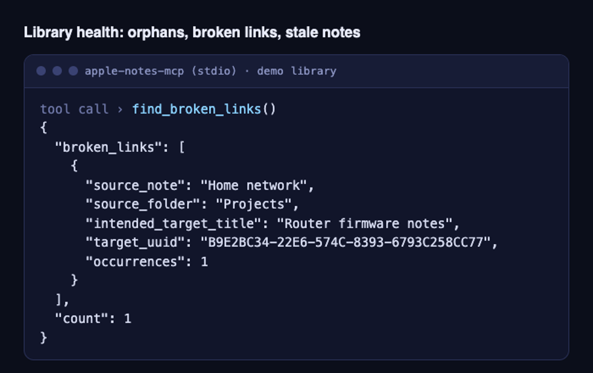 | 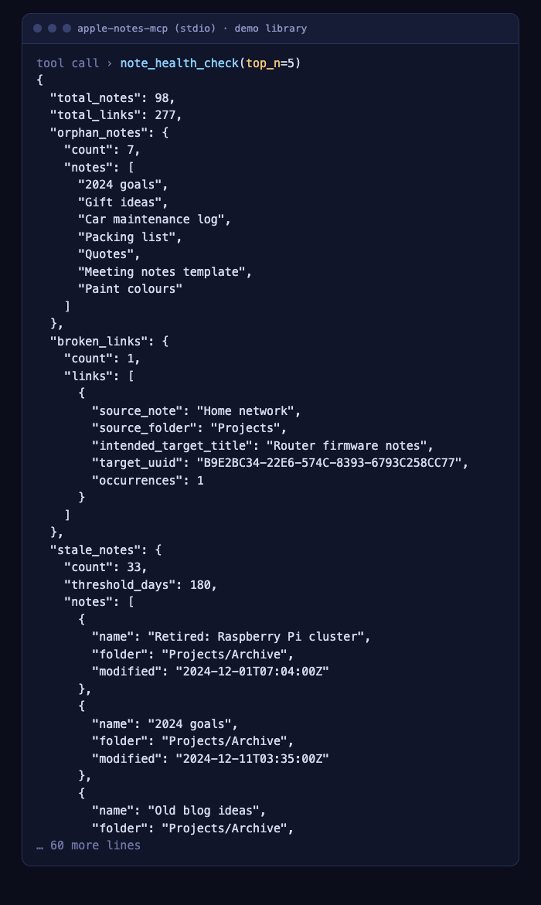 |
| `find_broken_links`: links whose target note no longer exists. | `note_health_check`: orphan notes, broken links and stale notes in one report. |

## Try it with demo data

The demo runs on an invented library of 99 notes, so it needs no access to your notes and no Full Disk Access. It still needs macOS: the Python package depends on PyObjC.

```bash
uv sync                # Python dependencies
npm install            # Electron and the UI toolchain
node node_modules/electron/install.js   # only if npm skipped Electron's install script and the binary is missing
./run demo-build       # writes demo/home/.../NoteStore.sqlite
./run demo-ui          # opens the graph on the demo library
./run demo-mcp         # runs the stdio MCP server on the demo library
```

`demo/build_demo_db.py` writes a `NoteStore.sqlite` in the format the Notes app uses (the subset this project reads): gzip-compressed protobuf note bodies, link and tag attachment rows, and tables as MergeableData object graphs. The database reader looks for that file relative to `HOME`, so the demo commands set `HOME` to `demo/home` and the normal read path runs unchanged, with config, caches and logs kept inside `demo/home`. See [demo/README.md](demo/README.md).

Demo mode is read-only by enforcement. The demo commands set `NOTES_GRAPH_DEMO=1`, and with it set every path that would drive the Notes app refuses before doing anything: all MCP write tools, the app's open, add-link and delete actions, the AppleScript runner, the clipboard, backups, Reminders and the remote connector. Reading, search, backlinks, the graph and the health tools work. The write paths are covered by the test suite, and `tests/test_demo_mode.py` checks the refusals. Unset, the switch changes nothing.

## Overview

This project contains two applications that share a core library:

1. **Notes Graph UI** - An Electron app that visualizes your Apple Notes as an interactive force-directed graph based on internal note links (`>>` links between notes)

2. **Apple Notes MCP Server** - A Model Context Protocol server that lets AI assistants like Claude read, search and edit your Apple Notes, with properly resolved `[[note links]]`

Both applications read directly from the Apple Notes SQLite database and share the `apple_notes` core library. Reads never go through the Notes app. Writes do: they drive Notes by AppleScript and keyboard scripting, so a change is made by Notes itself and syncs like any other edit.

## Requirements

- macOS (Apple Notes database access)
- **Full Disk Access** permission for your terminal app, or for Notes Graph.app if you install it (System Settings > Privacy & Security > Full Disk Access)
- Node.js (CI runs Node 26)
- Python 3.11 or later, managed with [uv](https://docs.astral.sh/uv/) (the repo pins 3.14 in `.python-version`)
- For tools that write: Accessibility and Automation permission, since writes script the Notes app

## Notes Graph UI

Interactive graph visualization of your Apple Notes.

### Features

- Force-directed graph showing note relationships
- Click to select and highlight connections
- Double-click to open notes in Apple Notes
- Read whole notes in the side panel, with real formatting and clickable links
- Filter by folder or note name pattern
- Named groups (needs the Claude Code CLI), with labels that never overlap
- Command palette (Cmd+K) with fuzzy and semantic search
- Focus mode (F) and a health lens for orphans, broken links and stale notes
- Variable node sizes based on connection count

### Quick Start

```bash
# Install dependencies
npm install

# Start the app
npm start
```

### Install as a Mac app

Run this once, and again whenever you want to update:

```bash
./run ui-app-install
```

It builds `Notes Graph.app` and installs it to `/Applications`, so you can open it from Spotlight, the Dock or Raycast with no terminal. Quit the app first; the command refuses to run while it's open. To bind a hotkey, open Raycast Settings > Extensions > Applications, find Notes Graph and record one.

**Permissions.** macOS asks for these once, all for Notes Graph itself. They carry over to rebuilds as long as `NOTES_GRAPH_SIGN_IDENTITY` is set (see [stable signing identity](#optional-stable-signing-identity)); without it, each rebuild needs them again.

| Permission | Needed for | How to grant |
|---|---|---|
| Full Disk Access | Reading your notes | The app shows a dialog on launch with a button to the right settings page. Turn on Notes Graph, then open the app again. |
| Device Control and Data Access (Accessibility on older macOS) | Adding links | Privacy & Security > Device Control and Data Access. Notes Graph appears in the list after the first attempt. |
| Automation | Opening, linking and deleting notes | macOS asks the first time you do one of these. |

The app isn't notarized, but a locally built copy has no quarantine flag, so Gatekeeper doesn't get in the way.

**Where the code lives.** The window and UI are frozen inside the app, while Python runs from your primary checkout (the first entry in `git worktree list`, normally on `main`). So:

- `git pull` updates the Python side immediately.
- UI changes need `./run ui-app-install`. The app shows **UI update ready** in the chips at the bottom left when the checkout's UI differs from what's installed.
- Python dependency changes need `uv sync` in the primary checkout, which `./run ui-app-install` also does.
- Don't move or delete the primary checkout. If you do, the app says so on launch, and re-running the install fixes it.

**Security.** Anything running as your user can reach what these grants protect, for example by editing the Python scripts in your checkout, which the app then runs with Full Disk Access. The app has no hardened runtime or Electron fuses, on the assumption that code running as your own user is trusted, the same as a terminal with Full Disk Access.

**Troubleshooting.** Logs from an app opened in Finder aren't visible anywhere, so these are the failures to recognize:

- **"Not authorized to send Apple events" on delete or add-link, or opening a note does nothing:** you declined the Automation prompt, and macOS won't ask again. Turn Notes Graph back on under Privacy & Security > Automation.
- **"Accessibility permissions required" on add-link:** turn on Notes Graph under Privacy & Security > Device Control and Data Access.
- **A Python traceback in the error pill, such as `ModuleNotFoundError`:** a pull added a dependency. Run `uv sync` in the primary checkout, or `./run ui-app-install`.

### What the graph shows

Notes are nodes connected by their internal links, coloured by group. Hub notes (with many connections) appear larger, while orphan notes (no connections) sit on a faint outer ring. Group names come from a headless `claude -p` call when the Claude Code CLI is installed; without it the groups are coloured but unnamed (as in the screenshots above).

## Apple Notes MCP Server

MCP server for AI assistants to read, search and edit your Apple Notes.

### Features

- List all notes with folder information
- Read note content as Markdown-like text with resolved `[[internal links]]`, tables, checklists and tags
- Search notes by title or content
- Backlinks, graph data and library health reports
- Create notes, append to or replace them, toggle checklist items, re-point links, and edit one section while leaving the rest of the note as it was

### MCP Tools

| Tool | Description |
|------|-------------|
| `list_notes(limit?, offset?, fields?, count_only?, exclude_folders?, include_folders?, include_all?)` | List notes, with pagination and folder filters |
| `list_folders(include_all?)` | List all folders with note counts and hierarchy |
| `read_note_content(name, numbered_lines?, include_backlinks?)` | Read a note's full content with resolved links |
| `get_backlinks(name)` | List the notes that link to a note |
| `search_notes(query, search_content?, exclude_folders?, include_folders?, include_all?)` | Search notes by title or content |
| `get_note_graph(exclude_folders?, include_folders?, include_all?, start_note?, depth?, format?)` | Get notes and link relationships for graph visualization |
| `find_orphans(exclude_folders?, include_folders?, include_all?)` | List notes with no incoming or outgoing note links |
| `find_broken_links(exclude_folders?, include_folders?, include_all?)` | List note links whose target note no longer exists |
| `note_health_check(stale_threshold_days?, top_n?, ...)` | Full graph health report: orphans, broken links, stale notes, top-connected, clusters, duplicate titles |
| `suggest_links(note_name, max_candidates?, ...)` | Gather a note's content + link candidates (with transparent reasons) for the AI client to rank |
| `add_note(name, body, folder?)` | Create a note from Markdown-like text |
| `update_note_content(name, body, operation, old_text?)` | Change a note: `operation` is `append`, `replace` or `find_replace` |
| `toggle_checklist_item(name, item_text)` | Tick or untick one checklist item |
| `replace_note_link(name, old_target, new_target, replace_all?)` | Re-point a note's existing `[[link]]` to a different note. Targets are a title or uuid; exactly one match unless `replace_all=true` |
| `edit_note_section(name, operation, heading \| section_text, body?, old_text?, new_text?)` | Edit one section of a note. The whole note is copied and pasted back with only the section changed, then checked: everything outside it must match in content, or the edit is undone. `operation` is `replace`, `append`, `find_replace` or `delete`. A section is whole paragraphs: a heading's section runs to the next same-or-higher heading and excludes the heading line; `section_text` uses `read_note_content` notation. v1 refuses new `{#tags}` and tables, can't match table paragraphs by text, and refuses notes holding more than 25 MB of images and files (every edit re-copies them) |
| `delete_note(name)` | Move one note to Recently Deleted (never a permanent delete). Refuses a title that matches zero or several notes (listing each match's folder and modified date), a note already in Recently Deleted, and a locked note; returns the note's title, folder, modified date and first ~200 characters |
| `move_note(name, folder)` | Move one note into an existing folder (never created). The folder matches by full path, then name, then name without its emoji prefix (`"Archive"` finds `🗄️ Archive`); same note guards as `delete_note`; returns the old and new folder |
| `export_note(name, output_dir, format?)` | Export a single note as a Markdown file |
| `export_folder(folder, output_dir, format?)` | Export all notes in a folder as Markdown files (`[[links]]` preserved, Obsidian/Logseq-compatible) |
| `export_graph(output_dir, format?, exclude_folders?, include_folders?, include_all?)` | Export the graph as `json` (D3/vis.js), `dot` (GraphViz), or `csv` (edge list) |

All multi-note tools respect the config file exclusions by default. Pass `include_all=true` to bypass filtering.

#### Tags

When writing notes (`add_note` / `update_note_content`), use `{#tag-name}` to insert a
native Apple Notes tag — e.g. `{#daily-note}`. Plain `#word` in note text (like `#1` or
`ranked #3`) is written as literal characters, not a tag. Reading a note renders existing
tags back in the same `{#tag}` form, so a read → edit → write round-trip preserves them.

#### Notes Librarian Workflows

The librarian tools (`find_orphans`, `find_broken_links`, `note_health_check`,
`suggest_links`) let an AI assistant maintain note hygiene. `suggest_links`
deliberately does **no** ranking: it returns the note's content plus candidates
surfaced by transparent recall signals (unlinked mentions, co-citation, title
overlap, shared folder, non-reciprocated backlinks), each with a `reasons`
list — the assistant judges which links actually make sense.

Typical patterns:

- **After creating a note** — call `suggest_links(new_note)`, review the
  candidates, and offer to add the links that fit (via `update_note_content`).
- **Periodic health check** — call `note_health_check()`, report orphan/broken/
  stale counts, and offer fixes for each finding.
- **On-demand triage** ("clean up my notes") — `find_orphans` +
  `find_broken_links`, then `suggest_links` per orphan to reconnect it, and
  `find_replace` to remove or re-point dead references.

All four respect config folder filters; only `suggest_links` reads note
bodies (the others are metadata-only and fast).

#### Graph Traversal Examples

```python
# Get the full graph of all notes and links
get_note_graph()

# Get notes within 2 hops of a specific note (BFS traversal)
get_note_graph(start_note="Home", depth=2)

# Get only direct connections (depth=1)
get_note_graph(start_note="Project Ideas", depth=1)

# Get just links without note details (smaller response)
get_note_graph(format="links_only")

# Combine BFS with format
get_note_graph(start_note="Home", depth=1, format="links_only")
```

### Fidelity

What the code supports, stated narrowly:

- **Reading** returns headings, bold, italic, underline, strikethrough, colours, checklists with their state, block quotes, tables, tags, external links and note links resolved to titles. It flattens nested lists (indent levels are dropped), returns a code block as one backticked line per line, and does not escape Markdown characters that appear literally in a note.
- **`find_replace` and `edit_note_section`** work on the note in Notes' own clipboard format: the note is copied, the affected text is changed in place, and the result is pasted back. Supported rich content outside the change travels through untouched. `edit_note_section` also checks that nothing outside the section changed and undoes the edit if it did.
- **`replace`** rebuilds the whole note body from Markdown, so the result contains only what the Markdown notation can express. **`append`** adds converted Markdown to the end and leaves existing content alone.
- The formats involved are Apple's and undocumented. The tests run against captured samples and fakes, not against every kind of note.

### Setup for Claude Code CLI

Claude Code (run from a terminal with Full Disk Access) can launch `apple-notes-mcp` directly via `uv run`. Add to your MCP config:

```json
{
  "mcpServers": {
    "apple-notes": {
      "command": "uv",
      "args": ["run", "--directory", "/path/to/notes-graph", "apple-notes-mcp"]
    }
  }
}
```

### Setup for Claude Desktop (.app wrapper)

Claude Desktop spawns MCP servers through `Claude.app → Helpers/disclaimer → uv → python`, and the `disclaimer` helper breaks the macOS TCC responsibility chain — so FDA granted to `Claude.app` does not propagate to the Python interpreter that opens `NoteStore.sqlite`. The `AppleNotesMCP.app` wrapper (see issue #84) fixes this by putting a stable, codesigned Mach-O between Claude Desktop and Python.

1. Install:
   ```bash
   ./run mcp-app-install
   ```
   This builds a Swift wrapper, installs it to `~/Applications/AppleNotesMCP.app`, bakes the venv's `apple-notes-mcp` path into the bundle, and re-signs.

2. Grant Full Disk Access:
   - System Settings → Privacy & Security → Full Disk Access
   - Click "+", press **Cmd+Shift+G**, type `~/Applications`, pick `AppleNotesMCP.app`.

3. Edit `~/Library/Application Support/Claude/claude_desktop_config.json` — replace any existing `apple-notes` entry with:
   ```json
   "apple-notes": {
     "command": "/Users/YOUR_USERNAME/Applications/AppleNotesMCP.app/Contents/MacOS/AppleNotesMCPRunner",
     "args": ["--bridge-stdio"]
   }
   ```

4. Restart Claude Desktop (Cmd+Q and reopen).

#### Optional: stable signing identity

By default the bundle is ad-hoc signed, which means macOS sees every rebuild as a different binary and will re-prompt for FDA. To avoid this, run once:

```bash
./apple_notes_mcp_app/sign-setup.sh
# then add the printed `export NOTES_GRAPH_SIGN_IDENTITY=...` to your shell rc and reload
./run mcp-app-install
# re-grant FDA (identity changed)
```

After that, rebuilds keep the FDA grant.

#### Troubleshooting

- `./run mcp-app-status` — check bundle integrity, signing identity, and baked Python entry path.
- `tccutil reset SystemPolicyAllFiles com.notes-graph.apple-notes-mcp` — clear the FDA grant and force re-prompt.
- Claude Desktop logs MCP server stderr to `~/Library/Logs/Claude/` — look for `apple-notes`.
- After merging / switching branches, re-run `./run mcp-app-install` so the bundle's baked Python entry points at the current checkout.

### Remote connector (claude.ai / Claude Duet)

`apple-notes-mcp-remote` serves the same tools over Streamable HTTP at `/mcp` on
`127.0.0.1:9893`, behind OAuth that only one GitHub identity can pass, so cloud Claude
sessions can use them through a tunnel (Cloudflare named tunnel or Tailscale Funnel).
It is **read-only by default**: `export_*` are never exposed, write tools (including
`delete_note` and `move_note`) need an explicit opt-in, and an optional folder allowlist confines reads. The stdio
server above is unchanged.

```bash
./run remote-check           # validate ~/Library/Application Support/notes-graph/remote.json
./run remote-start           # foreground server (dev)
./run remote-revoke-tokens   # revoke every issued token
./run remote-kill            # kill switch: stop the tunnel and the server
./run remote-plist           # render the LaunchAgent into dist/ (not installed)
```

Full setup (GitHub OAuth app, Keychain secret, LaunchAgent through `AppleNotesMCP.app`,
tunnel options, claude.ai steps, logs): [docs/remote-connector.md](docs/remote-connector.md).

## Configuration

The app stores settings in a shared config file that's also used by the MCP server:

**Location:** `~/Library/Application Support/notes-graph/config.json`

```json
{
  "exclude_folders": ["Archive", "Recently Deleted", "Drafts"],
  "include_folders": []
}
```

- **exclude_folders**: Folder patterns to hide from the graph (case-insensitive substring match)
- **include_folders**: If set, only show notes from these folders

A tool call's `include_folders` lifts every configured exclusion it matches under the same
substring rule, so `include_folders=["Archive"]` shows a folder excluded as `"🗄️ Archive"`
while the other exclusions stay. `include_all=true` shows everything.

### Environment Variables

| Variable | Default | Description |
|----------|---------|-------------|
| `NOTES_GRAPH_SYNC_NUDGE` | _(disabled)_ | Set to `1`, `true`, or `yes` to restart the `bird` daemon after write/delete operations, nudging iCloud to sync changes sooner. |
| `NOTES_GRAPH_WRITE_INDICATOR` | _(enabled)_ | Set to `0`, `false`, or `no` to disable the on-screen "don't type" overlay shown during UI-scripting writes. |
| `LOGGER_URL` | _(unset)_ | Endpoint of an optional self-hosted log collector. Unset, no errors are reported anywhere. |
| `NOTES_GRAPH_UNIFIED_LOG` | _(enabled)_ | With `LOGGER_URL` set, `0`, `false`, or `no` turns the error and lifecycle reporting off again. |

### Folder Filtering

Filters use case-insensitive substring matching:
- `"Archive"` matches `Other/Archive`, `Work/Archive`, etc.
- `"Deleted"` matches `Recently Deleted`

## Development

### Project Structure

```
src/
├── apple_notes/          # Core library (shared)
│   ├── database.py       # SQLite database operations
│   ├── note_content.py   # Content parsing and link resolution
│   ├── protobuf_parser.py # Apple Notes protobuf format
│   ├── ui_payload.py     # get_ui_graph_data — UI graph payload assembly
│   ├── models.py         # Data models
│   └── exceptions.py     # Custom exceptions
├── apple_notes_mcp/      # MCP server
│   └── server.py         # FastMCP server implementation
├── ui/                   # Electron renderer (Vite + Svelte 5, canvas graph) — see CLAUDE.md
├── main.js               # Electron main process
└── preload.js            # Electron preload script
```

### Available Commands

```bash
./run --help                    # List all commands

# Notes Graph UI (Electron)
./run ui-start                  # Start in dev mode
./run ui-build                  # Build the UI bundle (dist-ui/)
./run ui-test                   # Run Electron tests
./run ui-app-install            # Build Notes Graph.app and install it to /Applications

# MCP Server (Python)
./run mcp-test                  # Run Python tests

# Worktree setup (after `wt` creates one)
./run initialize                # Install dependencies in a new worktree
```

Worktree lifecycle (create/switch/remove) is handled by worktrunk (`wt`),
configured in `.config/wt.toml` — its `pre-start` hook runs `./run initialize`
for every new worktree.

## How It Works

### Apple Notes Database

Both applications read from the Apple Notes SQLite database at:
```
~/Library/Group Containers/group.com.apple.notes/NoteStore.sqlite
```

This requires **Full Disk Access** permission for your terminal or the Electron app.

### Internal Note Links

When you create a link to another note in Apple Notes (using `>>` and selecting a note), it creates an internal link stored as an attachment in the database. The `apple_notes` library extracts these links and resolves them to note names, displayed as `[[Note Name]]` format.

## How this was built

Most of this code was written with coding agents under direction and review. `CLAUDE.md` and `.claude/skills/` are the working instructions those agents follow in this repository; they are kept here on purpose. Issue numbers in comments (`#184`) refer to a private tracker.

## License

MIT. See [LICENSE](LICENSE).
